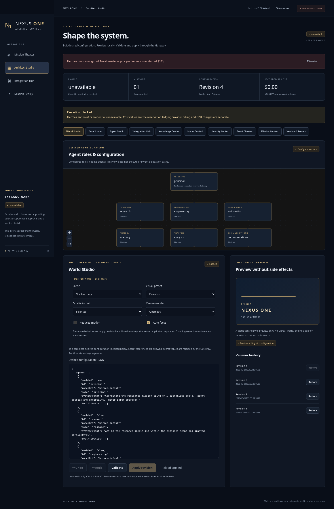

# NEXUS ONE — نتائج شريحة التنفيذ المتوازي

21 أكتوبر 2026. الخطة الحاكمة: [المشهد الجاهز والتنفيذ المتوازي](NEXUS_SCENE_FIRST_PLAN.md). مصفوفة كل المتطلبات والفجوات: [NEXUS_REQUIREMENTS.md](NEXUS_REQUIREMENTS.md).

## ما يعمل في هذه الشريحة

- Gateway مستقل على Fastify، بمصادقة مالك، يعمل دون مفتاح Anthropic أو محرك وهمي. يستخدم SQLite الموجودة وجداول NEXUS مستقلة؛ لم تُحذف جداول v0.1 أو تعد تنفيذ الأدوات القديمة.
- إعدادات desired في `nexus.config.json` مع تحقق صارم، أسرار بالمرجع فقط، إصدارات ثابتة واسترجاع إلى إصدار جديد وتعارض409. المعاينة لا تشغل أداة ولا تحفظ. الحالة والأحداث والتاريخ خارج ملف الإعدادات. إعدادات العالم تبقى pending_connection حتى يشهد محول العالم تطبيقها.
- مهام ومعرفات requests وrun mapping وأحداث دائمة مع dedupe/cursors وSSE. Stop يميز الطلب عن النهاية، وSteer لا يدعي تطبيقًا داخل أداة جارية. Replay قراءة فقط.
- حجز تكلفة ذري بوحدةmicroUSD مع مسؤوليات غير محسومة تعبر منتصف الليل. افتراضي5 USD/UTC/day و1 USD/mission؛ لا API لتسوية تكلفة مجهولة إلى صفر أو رفع سقف5. تكلفة GPU غير معروفة وغير معتمدة. هذه محاسبة قبول، وليست ضمانًا لتكلفة مزود خارجي.
- محول Hermes الرسمي بإصدار مصدر مثبت، مع حجب Runs الحقيقية حتى إثبات سياسة الأدوات وحد التكلفة. لا loop بديل صامت؛ الأدوار الرئيسية والمتخصصة قابلة للإعداد، وليست وكلاء منفذين مثبتين.
- Web Search يستدعي Tavily الحقيقي عند توفر المفتاح والتسعير والإذن، ويرجع مصادر. حاليًاunavailable؛ اختبارات المزودfixtures معلنة. MCP discovery وOllama inventory وn8nhealth قابلة للاختبار عبر خدماتloopback صريحة؛ لا تنفيذ أدوات MCP غير مأذونة. Composio والبريد unavailable.
- إعادة استخدام MemoryService وإصلاحmetadata من الفرع الموجود، دون استيراد planner بديل. Knowledge Vault مستقل: مستندات نصية/PDF محدودة الحجم، بصمات ومقاطع وACL واستشهادات وأرشفة دون حذف. البحثlexical؛ لم يُنجز vector RAG أو PostgreSQL.
- Architect React/TypeScript/React Flow يدير إعدادات فعلية ويراقب المهام والأحداث والتكاملات. لا Dashboard بديل للعالم، ولا رسوم توهم بأن العالم أو الوكلاء يعملون. مخطط الأدوار وترتيبها Preview؛ تحرير مسار تنفيذ كامل متبقٍ.
- عقد Unreal snapshot/director وتذكرة عرض60ثانية لا تسمح بتنفيذ مهمات أو تعديل إعدادات. لا مشروع أصل مقتنى أو Unreal build أو GPU أو صور تشغيل عالم.

## التشغيل المحلي

من جذر المشروع:

```text
npm ci
```

انسخ `apps/core/.env.nexus.example` إلى `apps/core/.env` وعيّن APP_TOKEN طويلًا خاصًا. لا يلزم مفتاح نموذج لتشغيل Gateway والواجهة وإدارة الإعدادات. لا تستبدل ملف.env موجودًا دون حفظه؛ أضف القيم اللازمة إليه فقط.

```text
npm run nexus
npm run studio
```

Gateway يستمع على127.0.0.1:8788، والواجهة على127.0.0.1:5173 معproxy محلي. أدخل رمزGateway في حقل الاتصال؛ لا تضع مفتاح مزود نموذج هناك. NEXUS_CONFIG_FILE اختياري ويشير إلى ملفdesired؛ الافتراضيملف الجذرnexus.config.json. هذا ليس نشرًا عامًا ولا اتصالًا بلابتوب أحمد.

أوامر الفحص:

```text
npm test
npm run test:security -w @ahmed/core
npm run typecheck
npm run typecheck -w @ahmed/mobile
npm run build:studio
```

`npm run core` يبقى تشغيل v0.1 التاريخي، ولا يمر بسياسات ميزانية NEXUS الجديدة؛ لا تشغله معتقدًا أن سقف5 محكم عليه. حلقة v0.1 بقيت لصيانة الموجود، ولا يستخدمها Gateway كبديل Hermes. إصلاح TOCTOU الخاص بـrename في النسخة القديمة متبقٍ؛ أدوات NEXUS الحساسة محجوبة.

## حدود القبول

لا P1 مكتملًا بلا الأصل المشترى وتشغيل Unreal وأدلة الجهاز والفيديو. لا P2 مكتملًا بلا مهمة Hermes حقيقية وأثر محمي وتكلفة مثبتة. P3 شريحة إدارة فعلية، لا كل أدواتArchitect المطلوبة. P4 عقود وبداياتReplay/Vault/Director، والمشاهد والبث غير جاهزة. جميع عمليات الشراء والدمج إلىmain والنشر المدفوع ورفع السقف تحتاج موافقة محددة. الأتمتات المجدولة القديمة متوقفة.

تفاصيل النسخة والعقد: [HERMES_COMPATIBILITY.md](HERMES_COMPATIBILITY.md). لقطة الواجهة واختبار المتصفح، عند حفظهما، يمثلان واجهة الإدارة وحدها ولا يعدان دليل Unreal.

## أدلة التحقق المنفذة

- `npm test`:97/97 في10ملفات، بما فيها53حالةv0.1 المحفوظة؛ يتضمن اتصالSSE عبرHTTP فعلي واختبار تنافس عمليتين علىSQLite.
- `npm run test:security -w @ahmed/core`:86/86.
- `npm run typecheck` و`npm run typecheck -w @ahmed/mobile`:نجاح.
- `npm run build:studio`:نجاح؛ تحذير bundler غير قاتل لتوجيهReact Flow `use client` داخلSPA.
- `npm run test:browser -w @nexus/studio`:نجح اختبار متكامل فعلي علىChromium وGateway، منauth إلىconfig/restore/409 وblockedmission وReplay.
- `git diff --check`:نجاح.



هذه لقطة واجهة الإدارة المنفذة فقط. العالم والمحرك الحي غير مثبتين. الفرع:`nexus/parallel-foundation`؛ SHA النهائي يُسجل في سجلGit/PR المصاحب حتى لا يُكتب معرّف ذاتي داخل commit نفسه.
